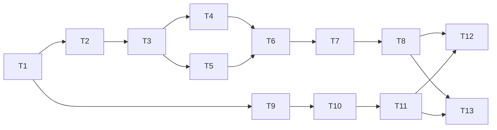

# Spec #1 实现记录

2026-09-17：用户通过 implement-spec 明确启动代码实现，取代规格发布阶段的暂缓开发要求。真实知识库迁移不属于本次开发验证；测试仅操作临时合成库。

## 交付约定

- 规格与任务：ZJPex/llm-wiki-organizer #1–#14，读取时均开放，无评论、认领或竞争 PR。
- 基线：main，`956fcf5bc4cf3502be9b12d98805424289228d25`；统一交付分支 `codex/raw-organizer-spec`。
- 规则：AGENTS.md、docs/agents/issue-tracker.md、docs/agents/domain.md、docs/agents/triage-labels.md；无额外 PR 模板、签名或 DCO 要求。
- 分任务工作树开发并合并；最终执行规范与规格双轴审查。
- 本地已有两份未跟踪计划文件属于用户工作，不纳入提交。
- 应用选用 Node.js ESM；明确支持范围，未知版本或关联格式阻塞历史迁移。

## 依赖图

任务编号 T1–T13 对应 Issue #2–#14。实现及验证证据随完成更新；任务被列出不表示已通过验收。

## 当前验证证据

- T1：预检页面与 HTTP 入口完成，4 项入口测试通过；合成库的浏览器实际填写、运行与报告展示通过。窄屏长路径／结构数据溢出已修复并复查。
- 兼容工具：固定上游 Rust 重扫实现的 20 项测试通过，包含无变化静默、等长内容变更、未维护快照的改名对照。该工具不等同于完整桌面重启或模型出口验证。
- GitHub Actions：提交 `20265f6` 的 Windows/Linux、Node 22/24 及真实上游重扫检查均通过。
- T2：完整恢复备份、独立验证副本、校验报告已集成；自动测试及合成库浏览器操作通过。
- T9：命名分析、审核及独立状态持久化已集成；固定模型响应的浏览器审核保存通过，确认源文件未移动。未调用用户模型。
- T10：已有分类推荐与审核路径冻结已集成；包含跨分支、同义分类和基线失效场景。
- Windows CI 实际检出短路径别名导致的关联检查及状态目录边界问题。已在本机用同类短路径复现，修复后正常及短路径环境的 19 项测试通过；提交 `b76893b` 的全部 CI 通过。
- T3、T11：分别进行单文件迁移和局部分类演化的集成验收。T4–T8、T12–T13 尚未完成。
