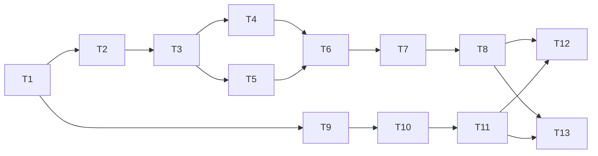

# Spec #1 实现记录

2026-09-17：用户通过 implement-spec 明确启动代码实现，取代规格发布阶段的暂缓开发要求。真实知识库迁移不属于本次开发验证；测试仅操作临时合成库。

## 交付约定

- 规格与任务：ZJPex/llm-wiki-organizer #1–#14，读取时均开放，无评论、认领或竞争 PR。
- 基线：main，`956fcf5bc4cf3502be9b12d98805424289228d25`；统一交付分支 `codex/raw-organizer-spec`。
- 规则：AGENTS.md、docs/agents/issue-tracker.md、docs/agents/domain.md、docs/agents/triage-labels.md；无额外 PR 模板、签名或 DCO 要求。
- 分任务工作树开发并合并；最终执行规范与规格双轴审查。
- 本地已有两份未跟踪计划文件属于用户工作，不纳入提交。
- 应用选用 Node.js ESM；明确支持范围，未知版本或关联格式阻塞历史迁移。

## 依赖图

任务编号 T1–T13 对应 Issue #2–#14。实现及验证证据随完成更新；任务被列出不表示已通过验收。

## 当前验证证据

- T1：预检页面与 HTTP 入口完成，4 项入口测试通过；合成库的浏览器实际填写、运行与报告展示通过。窄屏长路径／结构数据溢出已修复并复查。
- 兼容工具：固定上游 Rust 重扫实现的 20 项测试通过，包含无变化静默、等长内容变更、未维护快照的改名对照。该工具不等同于完整桌面重启或模型出口验证。
- GitHub Actions：提交 `20265f6` 的 Windows/Linux、Node 22/24 及真实上游重扫检查均通过。
- T2：完整恢复备份、独立验证副本、校验报告已集成；自动测试及合成库浏览器操作通过。
- T9：命名分析、审核及独立状态持久化已集成；固定模型响应的浏览器审核保存通过，确认源文件未移动。未调用用户模型。
- T10：已有分类推荐与审核路径冻结已集成；包含跨分支、同义分类和基线失效场景。
- Windows CI 实际检出短路径别名导致的关联检查及状态目录边界问题。已在本机用同类短路径复现，修复后正常及短路径环境的 19 项测试通过；提交 `b76893b` 的全部 CI 通过。
- T3、T11：单文件迁移和局部分类演化已集成。普通测试 27 项通过，1 项外部验证默认跳过；启用真实上游验证器后，迁移测试 7 项全部通过。已迁移合成副本另通过真实前端同步处理器与 Rust 联合验证，未产生摄取任务、删除、模型调用或前端副作用。
- 提交 `98e4c78` 的全部 CI 通过；流水线已增加带真实 Rust 验证器的迁移测试。Windows 本地可通过受信任启动配置调用 WSL 验证器，网页不能指定执行命令。
- 单文件页面已用新的合成备份完整走通审核与执行；结果显示模型调用尝试 0、迁移后重扫变更任务 0，详细验证数据折叠展示，恢复记录位置可查。
- T4、T5：已集成，普通及 Windows 短路径测试 32 项通过、3 项外部测试默认跳过；显式真实重扫全量 35 项通过，提交 `163258c` 全部 CI 通过。
- 同一 HTTP 批次补测 Raw 出链／反链、共享来源与真实 v1/v2 索引协作，真实 Rust 与前端联合验证均通过。另用合成库实际浏览器审核并执行这一组合，确认链接路径、共享来源、索引影响行数及重扫／向量验证结果可见。
- T6：已合入批量编译、依赖排除、大小写与交换、目录编号、持久计划及逐项报告。集成普通测试 38 项通过、4 项外部默认跳过；显式真实批量测试 6/6、前端联合 1/1 通过。
- 批量浏览器验收走通“纳入一项、排除一项”的真实共享索引迁移，显示部分成功及逐项结果；更换备份报告立即使旧审核计划失效。原库与恢复备份内容哈希不变。
- T7：已集成完整恢复与现场保留、原位／换目录恢复、进程中断续作和中文查询入口。普通全量 44 项通过、5 项外部默认跳过；显式真实恢复测试 7/7，通过实际子进程退出续作、共享来源、双表索引和绝对路径恢复。恢复副本另通过真实前端联合验证，模型尝试、副作用和变更任务为空，重扫前后快照／队列字节保持一致。
- 恢复浏览器验收将已迁移共享索引副本恢复到独立目录，原备份与现场均通过校验；服务进程重启后，同一页面可凭磁盘计划查询完整结果。
- T8：已集成冻结原库执行、同批证据门槛、原库内容／目录基线复核、故障恢复入口及持久结果查询。普通集成全量 56 项通过、5 项外部默认跳过；短路径真实 WSL 原库测试 10/10。实际合成原库通过前端联合验证，原库 UUID 保留，零变更任务、零模型尝试及零前端副作用，快照／队列字节不变。
- 原库浏览器验收复用先前审核、迁移与恢复证据，选中一项成功、排除一项留在原位，2 处引用与 2 张索引同步；原库标识保留，完整备份和验证副本内容哈希不变。所有操作对象均为临时合成库。
- T12–T13 已实现并集成；最终双轴审查及修复已完成，详见下文。
- 提交 `4391ed9` 的两轮 CI 均通过。新共享批次服务已通过真实 WSL 重扫的 3 项测试，覆盖持久化重启查询及完整备份／验证／恢复／原库调用链。
- Inbox 新增流程已在浏览器完整走通：内容分析、确认名称、复用分类、冻结审核和归档；重复执行未再次搬移，页面重载后可恢复同一报告。合成库摄取队列为空、原有设置不变、历史缓存未增加伪造记录。阶段文案及成功项目操作限制已修正并复查。
- 最终集成 `9ae5b70`：普通与 Windows 短路径全量均为 75 项、70 通过、5 外部用例默认跳过；共享批次、首次重构与 Inbox 显式真实 WSL 联合测试 13/13。首次重构测试含五层分类、长转写、导航、共享产出、低信息保留及两批分别重建备份基线。
- 首次重构浏览器验收实际检出 Windows LanceDB 长路径失败；原库与完整备份哈希不变。修复短产物目录名并增加规划前长度检查后，同一批次重新创建独立验证产物，完成两来源、四层目标目录、两处链接、两个向量表迁移与恢复演练。原库及副本模型尝试、重扫变更均为 0，成功结果另通过真实上游前端联合验证 1/1。
- Windows CI 检出的 Inbox 祖先目录短路径别名漏判已修复：先规范化两侧路径再做包含检查，短路径 Inbox 测试 8/8。集成提交 `9ae5b70` 的两轮跨平台及真实上游 CI 均通过。

## 最终审查与修复

### 真实库备份兼容补充

2026-09-17 实际备份在重定位阶段遇到上游原子写入残留，随后发现聊天正文、文件历史路径及审核来源路径。新增结构化适配：已知临时队列／快照逐字节保留，已识别记录的路径绑定至副本，历史正文保持原文，未知字段和外部路径继续阻塞。三份上游格式源码增加固定指纹。

后续冻结改名共用同一适配器，维护聊天引用、审核来源和文件历史 FNV-1a 查找键，禁止键冲突覆盖；逻辑计划归一化允许副本与原库复用相同决策。恢复日志覆盖所有记录的前后态，新增、缺失、修改或共享链接均停止，不覆盖中断后的用户内容。

- 全量 114 项：109 通过、5 项外部默认跳过。新增路径协议／相对路径边界再经定向测试通过。
- Windows 短路径的备份、恢复及原库测试 50 项：49 通过、1 项外部默认跳过。
- 显式真实 WSL 新增全链及恢复中断测试 10/10；合成库完成副本迁移、恢复演练及原库执行，正文保持不变。
- 对既有真实恢复备份先重新校验，再复制到独立检查目录。1,243 个状态文件完成重定位，1,237 份文件历史的现有键全部匹配固定上游算法。真实重扫变更任务 0、模型尝试 0，重扫前后副本哈希一致，原恢复备份哈希不变。原库、旧失败副本和原失败报告未修改；检查报告不是原库迁移授权。

### 原始整组交付

- T1–T13 全部完成，对应 Spec #1 与 Issue #2–#14，统一交付到 PR #15。
- 规范、规格两轴独立审查发现七项问题，由同一实现者修复；独立复核均关闭。原始结论及逐项修复见 [最终审查记录](final-review.md)。
- 修复提交 `6471030`：普通及 Windows 短路径全量各 97 项，92 通过、5 项外部默认跳过；显式真实 WSL 短路径关键测试 42/42。最后的同义分类编号增量又通过普通全量及真实首次重构 3/3。
- 修复版本的 Inbox 浏览器完整归档通过；另用全部排除、无文件操作的预览验证 55 条明细按 50+5 分页、切换历史分批及页码重置。此预览仅验证界面，不作为大批迁移证据。
- 新材料在审核后变成历史来源时停止归档；恢复续作遇到未知用户修改时保留并报告冲突；本地出链或反链无法等价维护的新来源保留原处；同义分类跨分支复用并保持最小空号分配。
