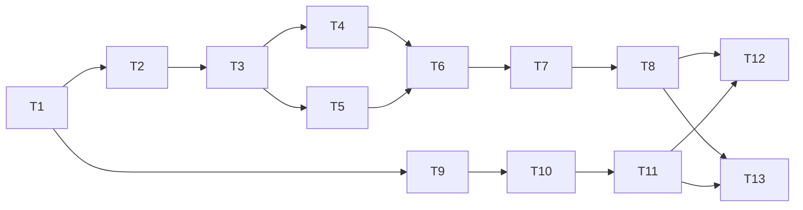

# Spec #1 实现记录

2026-09-17：用户通过 implement-spec 明确启动代码实现，取代规格发布阶段的暂缓开发要求。真实知识库迁移不属于本次开发验证；测试仅操作临时合成库。

## 交付约定

- 规格与任务：ZJPex/llm-wiki-organizer #1–#14，读取时均开放，无评论、认领或竞争 PR。
- 基线：main，`956fcf5bc4cf3502be9b12d98805424289228d25`；统一交付分支 `codex/raw-organizer-spec`。
- 规则：AGENTS.md、docs/agents/issue-tracker.md、docs/agents/domain.md、docs/agents/triage-labels.md；无额外 PR 模板、签名或 DCO 要求。
- 分任务工作树开发并合并；最终执行规范与规格双轴审查。
- 本地已有两份未跟踪计划文件属于用户工作，不纳入提交。
- 应用选用 Node.js ESM；明确支持范围，未知版本或关联格式阻塞历史迁移。

## 依赖图

任务编号 T1–T13 对应 Issue #2–#14。实现及验证证据随完成更新；任务被列出不表示已通过验收。
